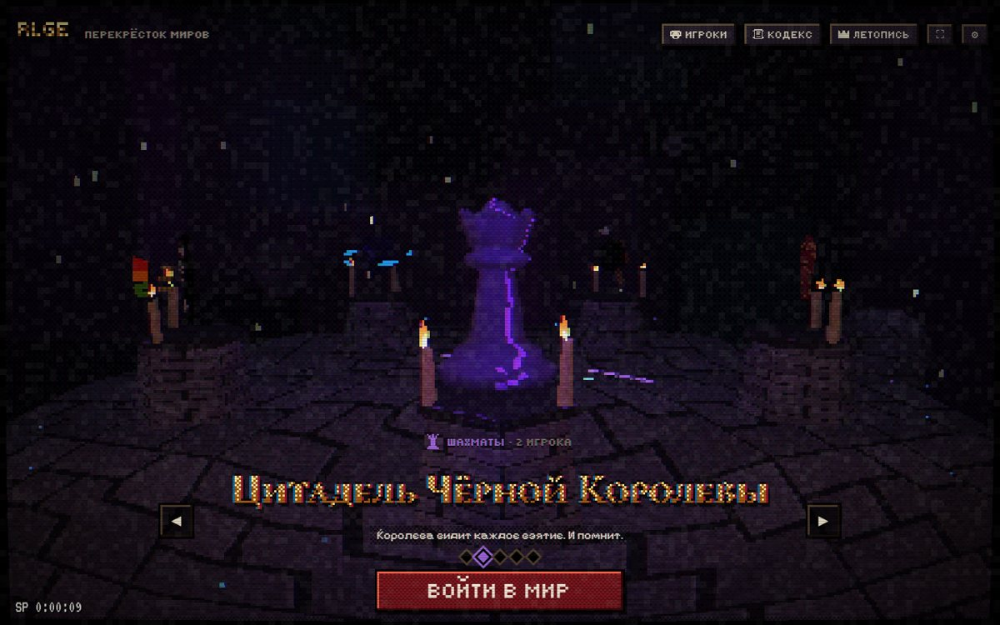
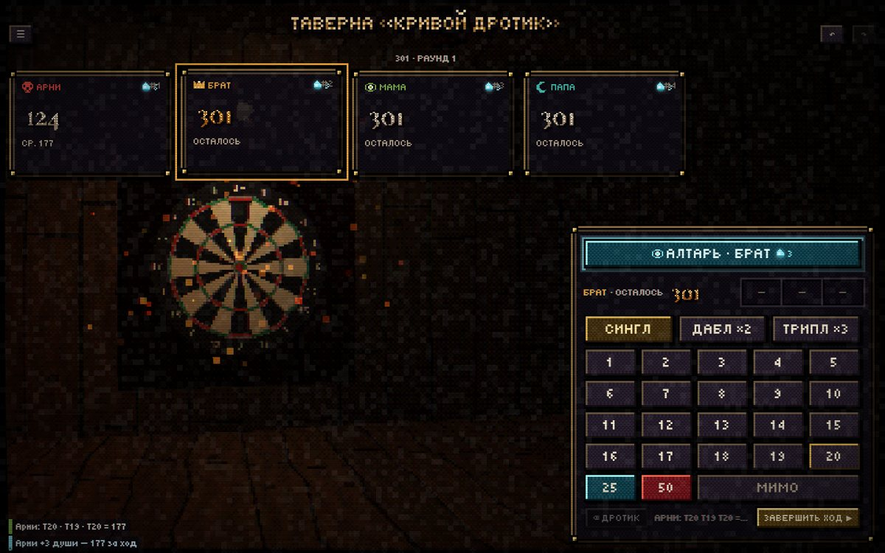
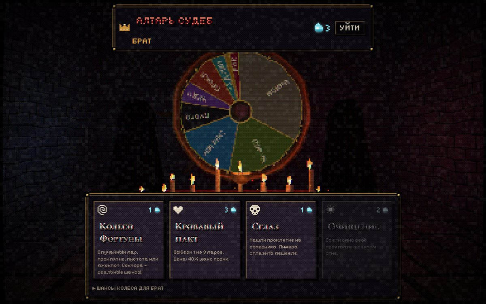
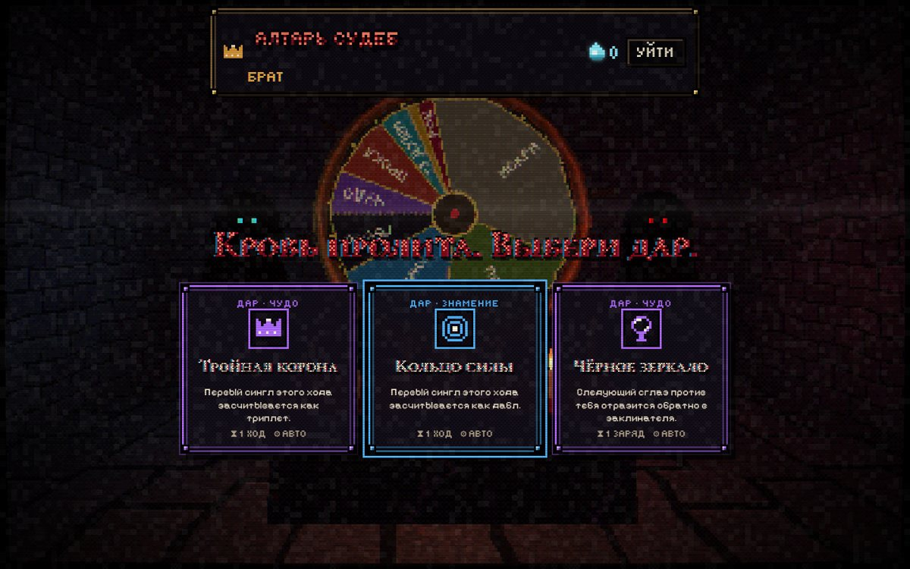
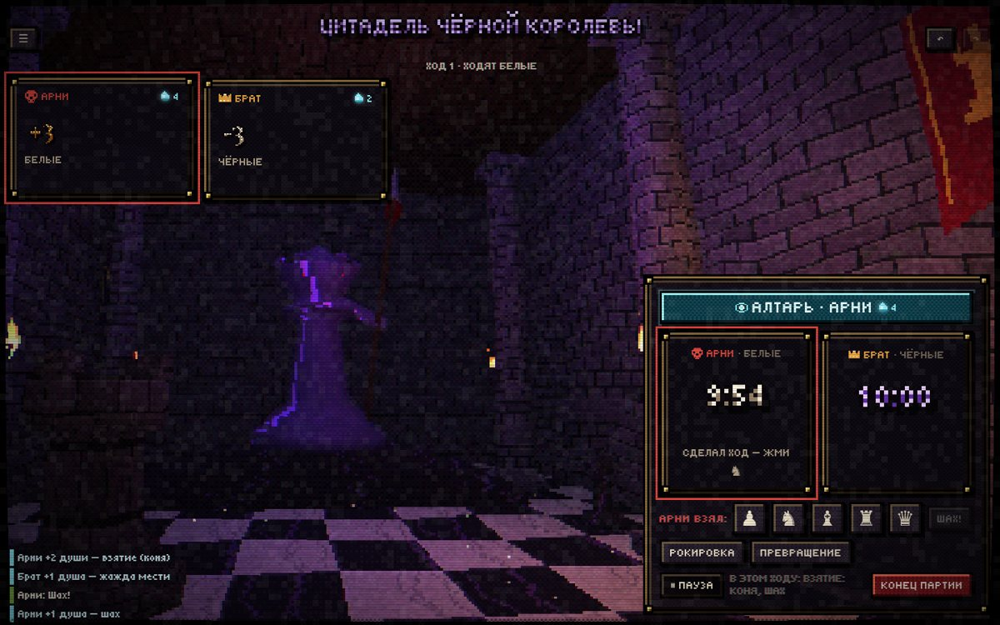
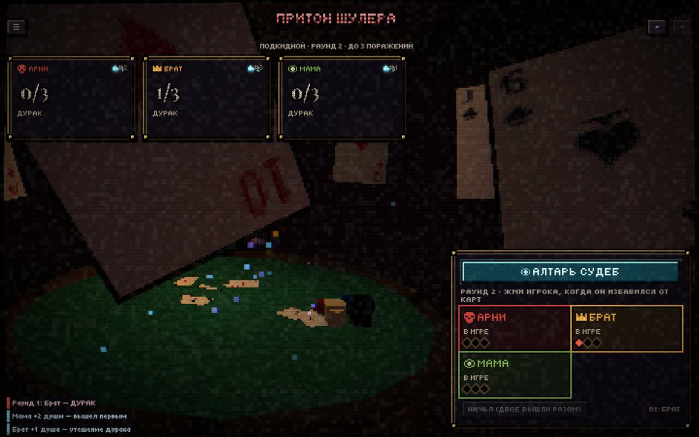
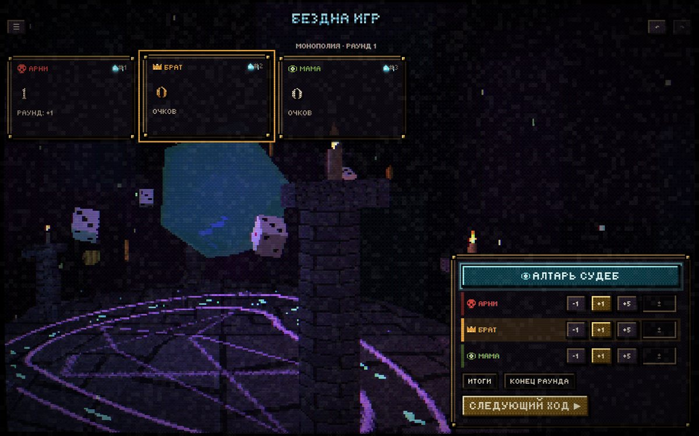
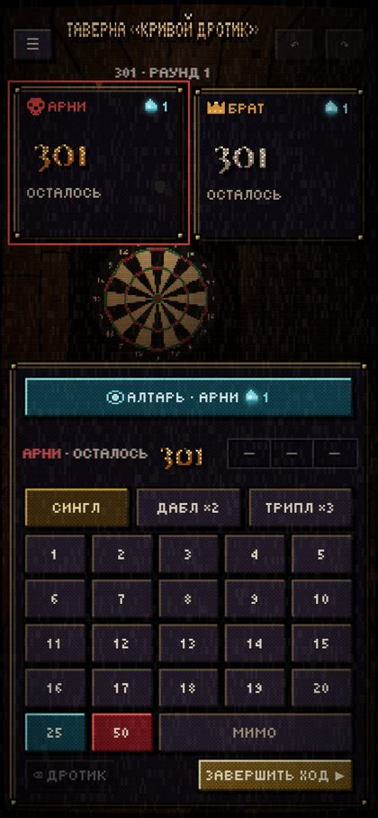
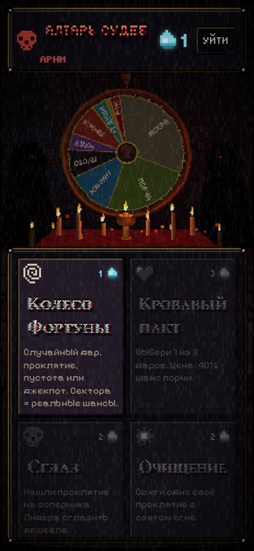

# Real Life Games Enhancer

**Усилитель настоящих игр.** Играете в дартс, шахматы, дурака или пинг-понг — как обычно, за настоящим столом.
Ноутбук или телефон рядом ведёт счёт, а поверх игры появляется roguelike-магия: за удачные действия вы получаете
**души**, тратите их на **Алтаре Судеб** и получаете **дары** и **проклятия** — новые правила лично для себя
или для соперника. Всё это — в мрачном, тёплом стиле PS1: дрожащие вершины, дизеринг, свечи и туман —
а интерфейс сделан из тех же пикселей: растровые готические заголовки, пиксель-арт рамки окон, VHS-плёнка
с шумом, трекингом и экранным меню видеомагнитофона.



## Что внутри

- **5 игр и 7 миров.** Дартс (X01 / «Охота») в таверне, шахматы с часами в Цитадели Чёрной Королевы,
  дурак в притоне Шулера, пинг-понг на подвальной арене, «любая игра» в Бездне — и Алтарь Судеб с колесом.
- **Счёт без бумажки.** Переборы, дабл-аут, подсказки закрытия, шахматные часы с инкрементом, подача в пинг-понге,
  круги и раунды — приложение считает само. Любое действие отменяется (↶ / Ctrl+Z).
- **Алтарь Судеб.** Колесо Фортуны (сектора = ваши реальные шансы), Кровавый пакт (выбор 1 из 3 даров),
  Сглаз (проклятие сопернику), Очищение.
- **≈100 перков.** «Четвёртый дротик», «Метеор ×3», «Конский прыжок», «Вязкое время», «Маска шута», «Двойное очко»,
  «Голос машины», «Поэт поневоле»… Часть применяется автоматически (⚙), часть — честное слово за столом.
- **Баланс.** Отстающим помогают боги и фора, лидера дешевле сглазить, после двух проклятий подряд — милость.
  Три уровня хаоса: Тихий омут · Сумерки · Безумие.
- **Живые миры.** Дротик реально летит в названный сектор 3D-мишени, Королева бьёт копьём при взятии,
  Шулер хохочет над дураком, d20 раскручивается от очков.
- **Пиксельный интерфейс.** Заголовки растеризуются в низком разрешении с дизер-градиентом, окна и кнопки —
  сгенерированные 9-slice рамки с заклёпками, переходы — дизер-растворение, поверх всего — VHS/ЭЛТ-слой
  (`● REC` при старте партии, `◀◀ REW` на отмену).
- **Звук без файлов.** Все эффекты и эмбиент синтезируются WebAudio.
- **Работает везде.** Браузер на ноутбуке, планшете, телефоне. PWA: ставится на экран и работает офлайн.
  Экран не гаснет во время партии. Автосохранение, летопись и зал славы.

| Дартс | Алтарь | Пакт |
|---|---|---|
|  |  |  |

| Шахматы | Дурак | Любая игра |
|---|---|---|
|  |  |  |

<p align="center">
  
  
</p>

## Как играть

1. Нажми на титульник — «пробуди» алтарь (браузер разрешит звук).
2. Выбери мир стрелками или свайпом → **Войти в мир**.
3. Добавь игроков (имена запомнятся), выбери правила и уровень хаоса → **Начать**.
4. Играйте по-настоящему, отмечайте события в пульте. Души капают сами.
5. Когда можно — жми **Алтарь**: крути колесо, заключай пакт, сглазь лидера.
6. Тапни карточку игрока — увидишь его дары и проклятия, «Использовать» для ручных перков.

Правила всех игр, доход душ, шансы колеса и все перки — в **Кодексе** (кнопка в хабе и в паузе).

## Запуск

```bash
npm install
npm run dev        # http://localhost:5173
npm test           # тесты логики и экономики
npm run build      # продакшен-сборка в dist/
```

Требуется Node 20+.

## Деплой (GitHub Pages)

В репозитории есть workflow `.github/workflows/deploy.yml`. Один раз:

1. **Settings → Pages → Build and deployment → Source: GitHub Actions.**
2. Запушить в `main` (или **Actions → Deploy to GitHub Pages → Run workflow**).

Сайт появится по адресу `https://<user>.github.io/real_life_games_enhancer/`. Сборка использует относительные пути,
так что подойдёт и любой другой статический хостинг (Netlify, Vercel, Cloudflare Pages, свой nginx).

## Технологии

Vite · React 19 · TypeScript · Three.js (самописный PS1-рендер на шейдерах) · zustand + immer · motion ·
WebAudio · vite-plugin-pwa · Vitest · Playwright (визуальная проверка).

## Документация

- [CLAUDE.md](CLAUDE.md) — гид по коду для Claude Code и людей
- [docs/GAME_DESIGN.md](docs/GAME_DESIGN.md) — экономика, баланс, перки, правила алтаря
- [docs/ART_DIRECTION.md](docs/ART_DIRECTION.md) — как устроен PS1-стиль, миры, UI, звук
- [docs/ARCHITECTURE.md](docs/ARCHITECTURE.md) — слои, поток данных, как добавить игру
- [docs/ROADMAP.md](docs/ROADMAP.md) — что дальше: новые игры, мультиплеер по комнатам, распознавание дротиков камерой
